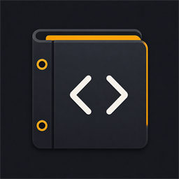
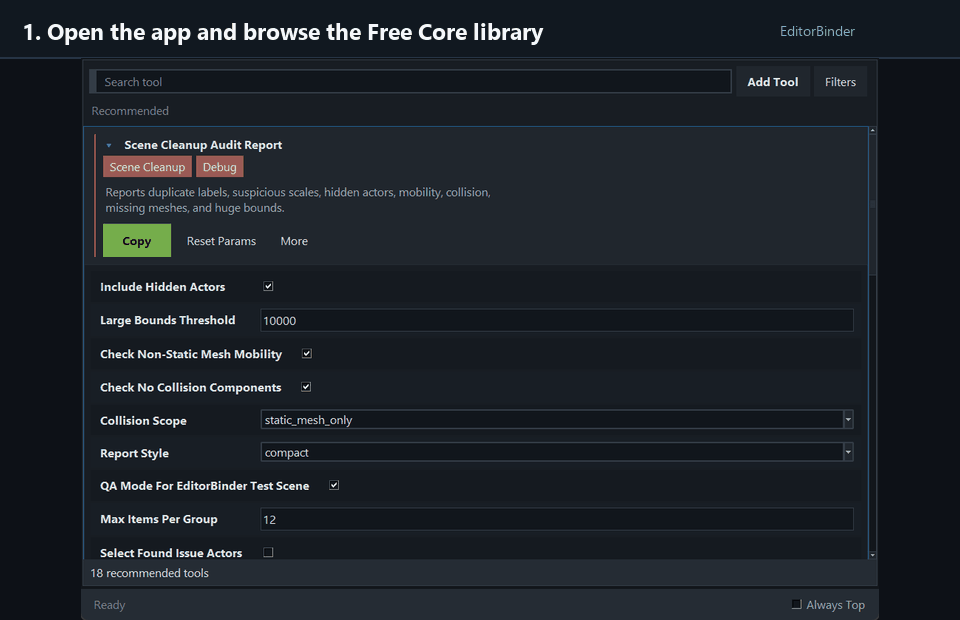
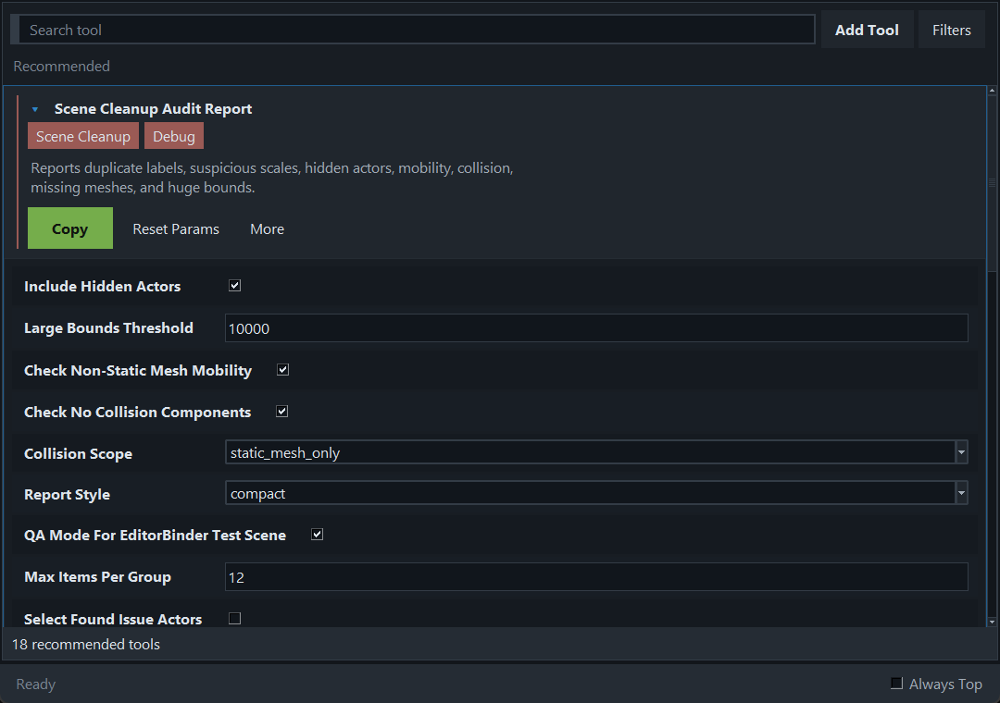
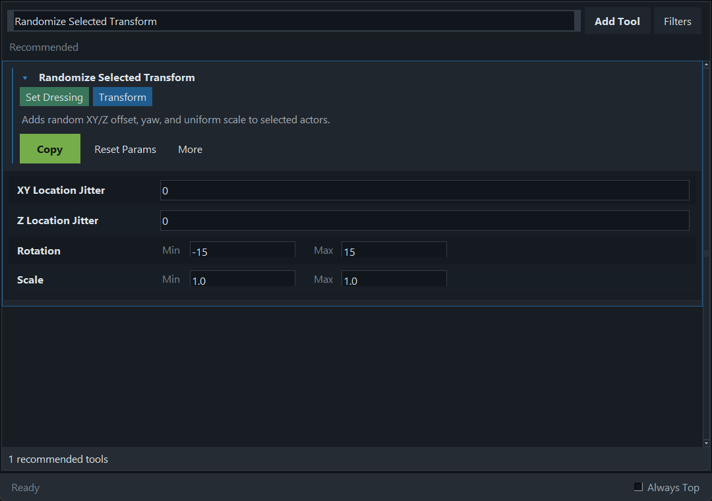
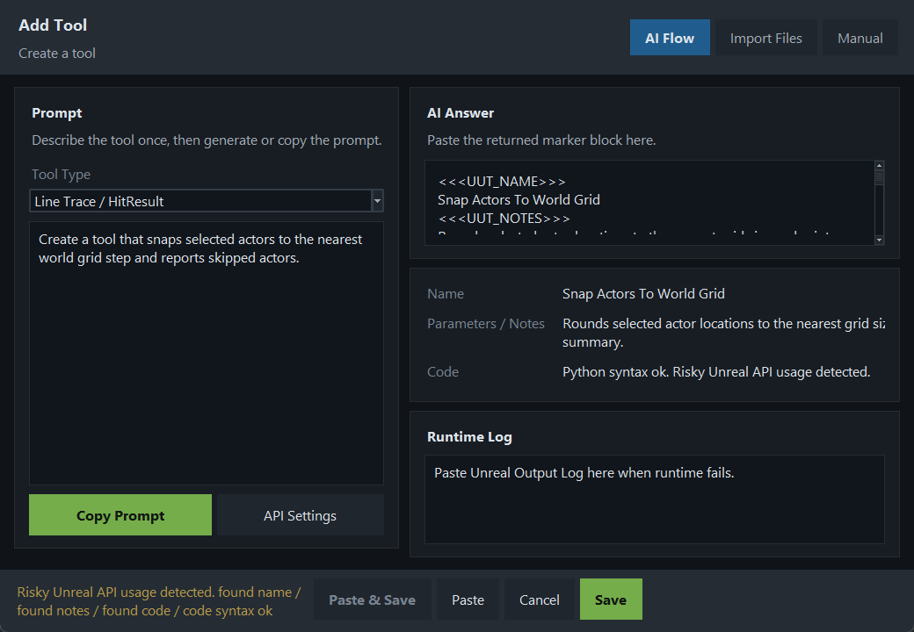
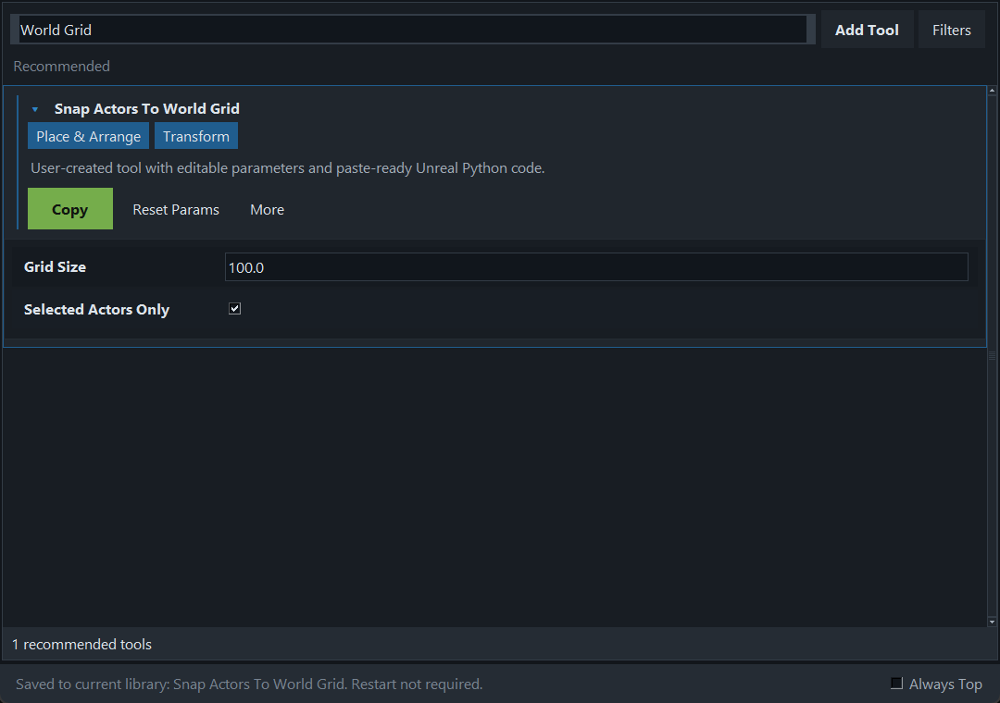

  

<h1 align="center">EditorBinder</h1>

  <strong>Reusable Unreal Engine tools, one click away.</strong> 
  A local-first Windows desktop toolkit for parameterized Unreal Engine Python Editor scripts.

  
  
  
  
  

  <a href="https://github.com/bartuom/editorbinder/releases/latest"><strong>Download for Windows</strong></a>
  | <a href="QUICKSTART.md">Quickstart</a>
  | <a href="docs/">Documentation</a>
  | <a href="CONTRIBUTING.md">Contribute</a>

  

> **AI-powered, not AI-dependent.** Keep everyday operations fast and predictable with ready-to-use tools. Bring in AI when you want to create, repair or extend them, not every time you need to use one.

## Why EditorBinder?

AI agents and MCP are useful when a task needs reasoning, exploration or several coordinated steps. But not every Unreal Editor operation needs an agent, a prompt and a model call.

If you already know what you want to do, a direct tool is often the better interface: find it, set a few parameters, press a button or a key, and move on. It is repeatable, easy to inspect and does not depend on an AI response.

EditorBinder focuses on that direct workflow. It keeps useful Unreal Python scripts in a searchable desktop library and makes them easy to reuse. AI helps you create and improve tools when you need something new.

**MCP and direct tools are complementary.** MCP gives agents a way to work with tools. EditorBinder gives developers a way to use known tools immediately. The current release is a desktop application and does not include an MCP server; agent integration is a possible direction for the same reusable tool library.

## How it works

1. **Choose a tool.** Search the library or browse your saved tools.
2. **Set parameters.** Adjust values exposed by the selected tool.
3. **Copy it.** Click **Copy** or press **Enter**.
4. **Run it in Unreal.** Paste the code into Unreal Editor's Python Console and execute it.

EditorBinder does not install into Unreal Engine and does not execute scripts itself. You stay in control of what gets pasted and run.

## What you get

### Ready-to-use tools

- 21 tools included in the Free Core.
- Search, categories, workflow and role filters.
- Favorites and recently copied tools.
- Editable parameters with support for strings, paths, numbers, booleans and enums.
- Keyboard navigation for quick access.

### Your own reusable library

- Create, edit and organize your own tools.
- Keep a local library instead of hunting through old projects and chat histories.
- Import tools from ZIP packs, JSON, Python files, text files, clipboard content or folders.
- Export individual tools and shareable tool packs.
- Back up and restore your library.

### AI-assisted authoring

Use AI when it adds value, then keep the result as a reusable tool.

- **Copy Prompt:** prepare a structured prompt for ChatGPT, Gemini or another AI assistant.
- **Generate via API:** optionally generate a tool directly in EditorBinder using a configured OpenAI-compatible API.
- **Review before saving:** inspect the generated name, notes, parameters and Python code.
- **Fix Prompt:** send an existing tool and its error context back to an AI assistant for a correction.

The API workflow supports presets for OpenAI, OpenRouter and DeepSeek, as well as custom OpenAI-compatible endpoints. API credentials are read from environment variables. The normal tool library and copy/paste workflow do not require an API key, and EditorBinder does not contact an AI service unless you explicitly use an AI feature.

## Keyboard shortcuts

| Key | Action |
| --- | --- |
| <kbd>Ctrl</kbd> + <kbd>F</kbd> | Focus the tool search |
| <kbd>Ctrl</kbd> + <kbd>N</kbd> | Open Add Tool |
| <kbd>Enter</kbd> | Copy the selected tool |
| <kbd>Space</kbd> | Focus the first parameter of the selected tool |
| <kbd>Up</kbd> / <kbd>Down</kbd> | Select the previous or next tool |
| <kbd>Delete</kbd> | Delete the selected tool |

Shortcuts apply in the main EditorBinder window. Text-entry controls keep their normal keyboard behavior.

## The Free Core

The 21-tool Free Core covers common scene cleanup, selection, placement, auditing and batch editing.

<strong>See all 21 bundled tools</strong>

1. Scene cleanup audit report.
2. Distribute selected actors in a grid.
3. Organize selected actors by Static Mesh.
4. Find broken or suspicious actors.
5. Transform selected actors.
6. Randomize selected transform.
7. Snap selected actors to ground.
8. Move selected actors to an Outliner folder.
9. Rename selected actors by pattern.
10. Replace text in selected actor labels.
11. Set collision profile on selected actor components.
12. Select actors using the same Static Mesh asset.
13. Set selected actor mobility.
14. Flatten selected actors to the same Z height.
15. Reset bad selected actor scale.
16. Select actors by label text.
17. Select actors by class name.
18. Report selected actors summary.
19. Select actors by material name or asset path.
20. Batch add, remove or replace Actor Tags with undo support.
21. Audit missing material assignments on selected actors.

The tracked default library is <code>data/tools.json</code>. It contains the bundled Free Core seed, not your personal working library.

## Screenshots

| Tool library | Editable parameters |
| --- | --- |
|  |  |

| Create a tool with AI | Save a custom tool |
| --- | --- |
|  |  |

## Download

**Latest release: [EditorBinder v0.1.3](https://github.com/bartuom/editorbinder/releases/tag/v0.1.3)**

| Package | Download | Use it when |
| --- | --- | --- |
| Windows EXE | [EditorBinder-0.1.3-win-x64.exe](https://github.com/bartuom/editorbinder/releases/download/v0.1.3/EditorBinder-0.1.3-win-x64.exe) | Recommended for most Windows users. |
| Portable ZIP | [EditorBinder-0.1.3-win-x64.zip](https://github.com/bartuom/editorbinder/releases/download/v0.1.3/EditorBinder-0.1.3-win-x64.zip) | You want the unpacked portable application folder. |
| Source/BAT ZIP | [EditorBinder-source-0.1.3.zip](https://github.com/bartuom/editorbinder/releases/download/v0.1.3/EditorBinder-source-0.1.3.zip) | You want the lightweight source package and BAT launch workflow. |

Use the official [GitHub Releases page](https://github.com/bartuom/editorbinder/releases/latest) for future versions. GitHub's automatically generated **Source code** archives are repository snapshots for developers, not the recommended Windows application download.

The Windows EXE is currently unsigned. Microsoft Defender SmartScreen may show an **Unknown publisher** warning on first launch. Download only from the official GitHub Releases page. If you trust the file, choose **More info** and then **Run anyway**. Code signing remains a release-hardening goal.

See [docs/downloads.md](docs/downloads.md) for the full download guide.

## Quick start

1. Download and launch the Windows EXE.
2. Choose a tool from the library.
3. Adjust any parameters shown for that tool.
4. Press **Enter** or click **Copy**.
5. Open Unreal Editor's Python Console, paste the script and run it.

To create your own tool, open **Add Tool**, describe the workflow and either copy the prompt to an AI assistant or use the optional API generation workflow. Review the returned code and parameters before saving.

**Safety:** EditorBinder copies scripts for you; it does not execute them in Unreal. Always inspect scripts before running them in a production project. Test new or modified tools in a disposable project or a copy of your level first.

## Run from source

The source/BAT package runs without creating a virtual environment or installing third-party packages. Double-click:

~~~text
run_app.bat
~~~

Other useful launch helpers:

- <code>install_shortcuts.bat</code> adds Desktop and Start Menu shortcuts.
- <code>reset_window.bat</code> resets the saved window position and size.
- <code>enable_portable_mode.bat</code> creates <code>portable.flag</code>, keeping the library and settings in the local <code>data</code> folder.

To run the Python module manually:

~~~powershell
$env:PYTHONPATH = "src"
python -m editorbinder
~~~

## Source/BAT package contents

The lightweight source/BAT ZIP is an end-user package. It includes the app, Free Core seed, documentation, icon, license files and the launch helpers:

~~~text
run_app.bat
install_shortcuts.bat
reset_window.bat
enable_portable_mode.bat
run_app.pyw
assets\editorbinder.ico
assets\editorbinder.png
src\
data\tools.json
docs\
README.md
QUICKSTART.md
CHANGELOG.md
LICENSE.txt
NOTICE.txt
SUPPORT_POLICY.md
CONTRIBUTING.md
SECURITY.md
CODE_OF_CONDUCT.md
requirements.txt
pyproject.toml
~~~

The package intentionally excludes the test suite, release build helpers, optional pack source files and local runtime files such as <code>data\user_tools.json</code> and <code>data\settings.json</code>.

## Local data

EditorBinder is local-first. Your working library and settings are stored on your computer.

- Source and portable runs use <code>data/user_tools.json</code> and <code>data/settings.json</code>.
- Packaged builds normally use the <code>%APPDATA%\EditorBinder</code> folder.
- The bundled Free Core seed remains in <code>data/tools.json</code>.

See [docs/tool_packs.md](docs/tool_packs.md) for import and export formats, and [docs/ai_workflow.md](docs/ai_workflow.md) for AI authoring, parameters and fix prompts.

## Documentation

- [QUICKSTART.md](QUICKSTART.md) - first-run guide.
- [docs/downloads.md](docs/downloads.md) - which release asset to download.
- [docs/walkthrough.md](docs/walkthrough.md) - visual walkthrough.
- [docs/ai_workflow.md](docs/ai_workflow.md) - AI-assisted creation, API setup and parameter format.
- [docs/tool_packs.md](docs/tool_packs.md) - importing and sharing tool packs.
- [docs/unreal_api_notes.md](docs/unreal_api_notes.md) - Unreal Python API notes and known pitfalls.
- [CONTRIBUTING.md](CONTRIBUTING.md) - how to contribute.
- [SUPPORT_POLICY.md](SUPPORT_POLICY.md) - support policy.
- [SECURITY.md](SECURITY.md) - security reporting.

## Development

Requirements: Python 3.10 or newer.

Run the test suite from the repository root:

~~~powershell
$env:PYTHONPATH = "src"
python -m unittest discover -s tests
~~~

Run static checks:

~~~powershell
python -m ruff check src tests
python -m compileall -q src tests
~~~

Build the source/BAT package:

~~~powershell
python tools\package_source_release.py
~~~

Build the Windows EXE and portable ZIP:

~~~powershell
python tools\package_windows_release.py
~~~

The current release was validated with 215 automated tests and Windows CI on Python 3.10, 3.11 and 3.12.

## License

EditorBinder is released under the [MIT License](LICENSE.txt). See [NOTICE.txt](NOTICE.txt) for third-party notices.
